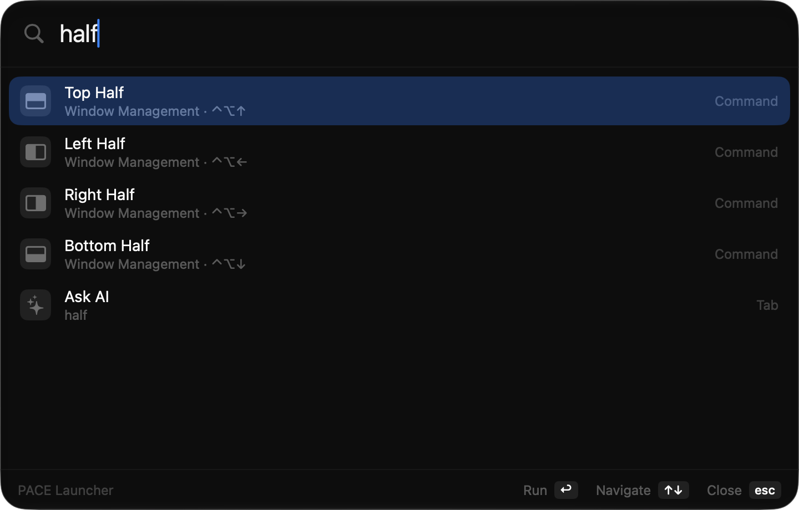
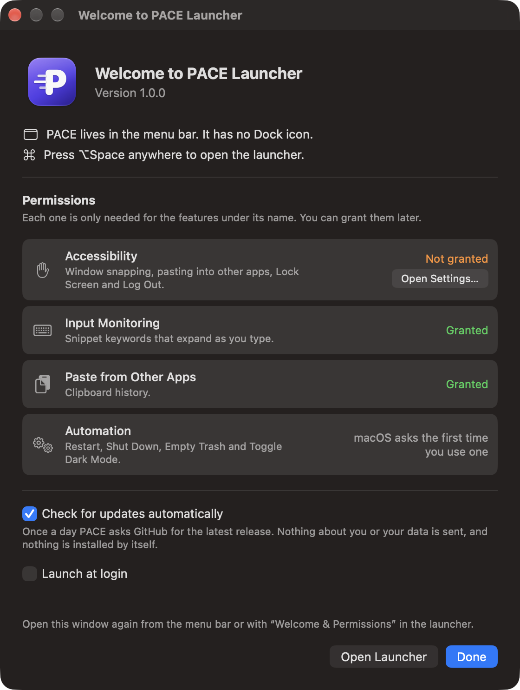

<p align="center">
  
</p>

<h1 align="center">PACE Launcher</h1>

<p align="center">
  A free, open-source launcher for macOS. Apps, calculator, clipboard history, snippets, window snapping and more, on one shortcut, without an account or a subscription.
</p>

<p align="center">
  <a href="https://github.com/ahmadrio/pace-launcher/releases/latest"><b>Download the latest release</b></a>
  ·
  <a href="docs/INSTALL.md">Installation guide</a>
  ·
  <a href="PRIVACY.md">Privacy</a>
</p>

<p align="center">
  
</p>

## Before you install
- **macOS 27 on Apple silicon** only.
- **Not notarized by Apple.** PACE is a free project without a paid Apple Developer membership, so macOS blocks the first launch. You approve it once in **System Settings › Privacy & Security › Open Anyway**. The [installation guide](docs/INSTALL.md) walks through it, including how to check the download's SHA-256.

## Features
Press **⌥Space** anywhere. The app you were using stays in front, so pasting and window commands act on it.

- **Search and open apps** with fuzzy matching (`vsc` finds Visual Studio Code). Results learn from what you use.
- **Calculator**: arithmetic, units (`10 km to mi`, `100 f in c`), currencies (`100 usd to idr`), number shorthands (`1jt + 500rb`, `10k usd`), and dates and time zones (`time in tokyo`, `days until 17 aug`, `5pm in london`). ⏎ copies the result.
- **Clipboard history** (⇧⌥C or `clip`): text, rich text, files and images. Search, pin, paste as plain text, and choose how long history is kept. Copies marked as concealed by password managers are skipped.
- **Snippets** with `{date}`, `{time}` and `{clipboard}` placeholders. Paste them from the launcher, or type a keyword like `;addr` in any app to expand it.
- **Window snapping**: halves, quarters, maximize, center and restore, with ⌃⌥ shortcuts.
- **Notes**: a floating Markdown window that saves as you type.
- **Quicklinks**: saved URLs with `{query}`, such as `gh pace launcher` to search GitHub, each opening in the browser you choose.
- **Script commands**: run your own scripts with arguments, a confirmation step, and output in the launcher or a small message. A header such as `# @pace.title Deploy` makes a script appear; the `@raycast.*` header format is read as well.
- **AI chat and translation** that run on your Mac (Apple's on-device model and translation).
- **Emoji picker** with skin tones, **system commands** (lock, sleep, log out, restart, shut down, empty trash, toggle dark mode), **themes**, and **custom shortcuts** for almost every command.
- **Optional iCloud sync** for snippets, notes, scripts and settings, with clipboard backups.

## First launch
A welcome window explains where PACE lives (the menu bar; there is no Dock icon), how to open it, and what each permission is for, with its live status. Reopen it any time with **Welcome & Permissions…** in the menu bar.

<p align="center">
  
</p>

## Privacy
PACE has no account, no analytics and no tracking. Your data stays on your Mac unless you turn on iCloud sync. It connects to the internet for two things only: exchange rates when a currency conversion is on screen, and a daily update check you can turn off. Details are in [PRIVACY.md](PRIVACY.md).

## Updates
PACE checks GitHub once a day and tells you when a new version is out. It never installs anything by itself: download the new DMG, replace the app, and approve it once with **Open Anyway**. Your data and permissions are kept.

## Building from source
You need the Command Line Tools with Swift 6.4 or later (`xcode-select --install`). Xcode is not required.

```sh
make test     # unit tests for the core logic
make run      # build, install into ~/Applications and open
```

`make run` installs the same app (same bundle ID) as a release; don't keep both installed. Without the maintainer's signing certificate, builds are signed ad-hoc and macOS asks for permissions again after every build. [docs/INSTALL.md](docs/INSTALL.md#building-from-source) shows how to create your own certificate once. Releases are made as described in [docs/RELEASING.md](docs/RELEASING.md).

The code is split into `Sources/PACELauncherCore` (logic without AppKit, covered by the tests in `Tests/`) and `Sources/PACELauncher` (the AppKit and SwiftUI app). `HANDOFF.md` and `docs/superpowers/` are the project's working notes, in Indonesian.

## License
PACE Launcher is free software under the [GNU General Public License v3.0](LICENSE).
